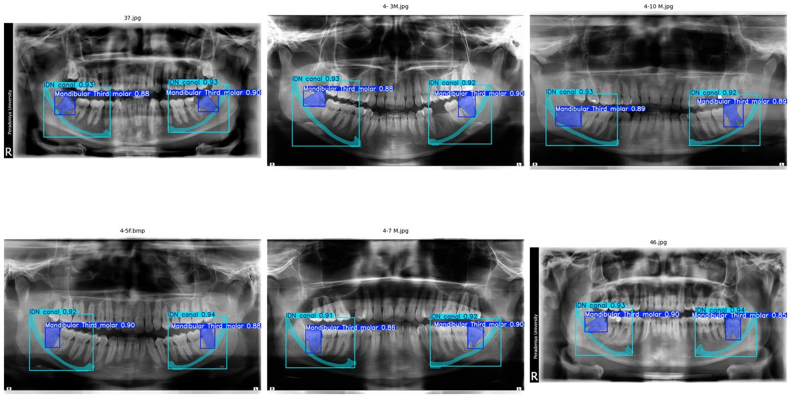
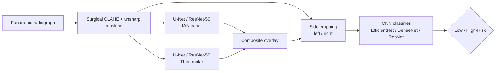
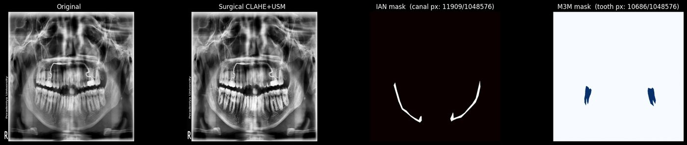
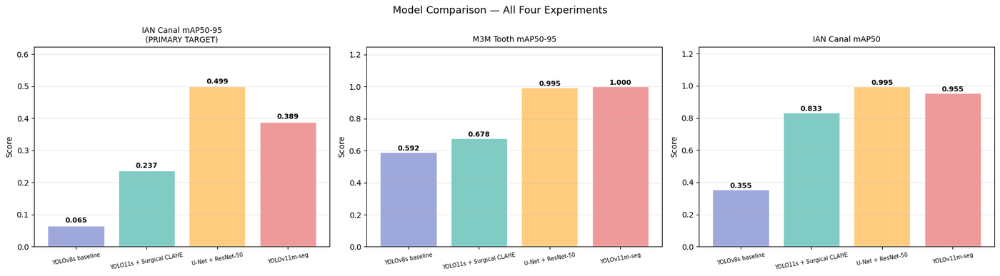
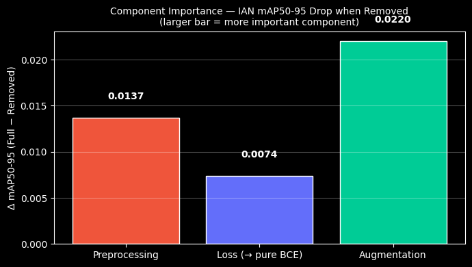
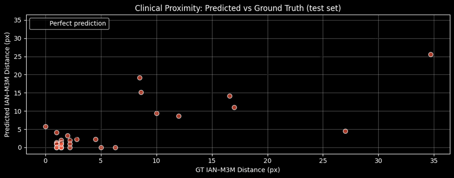
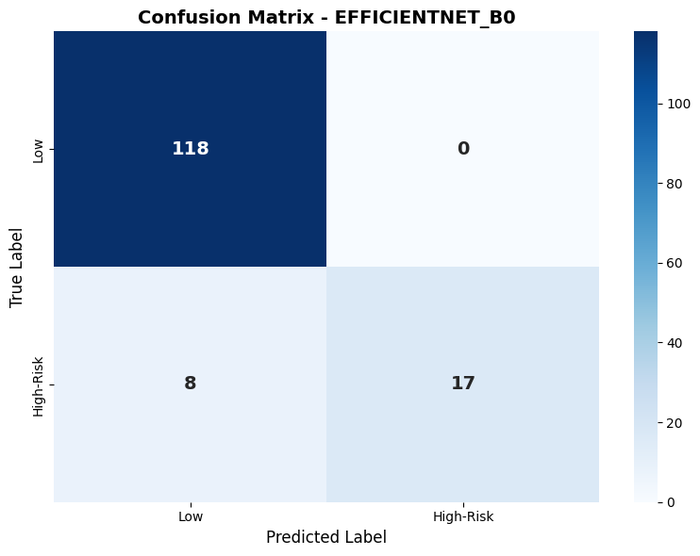
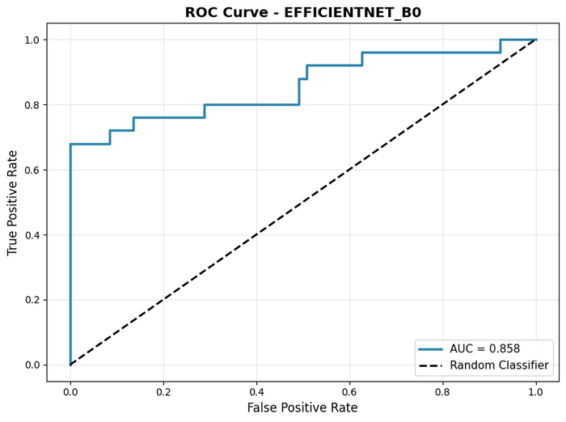
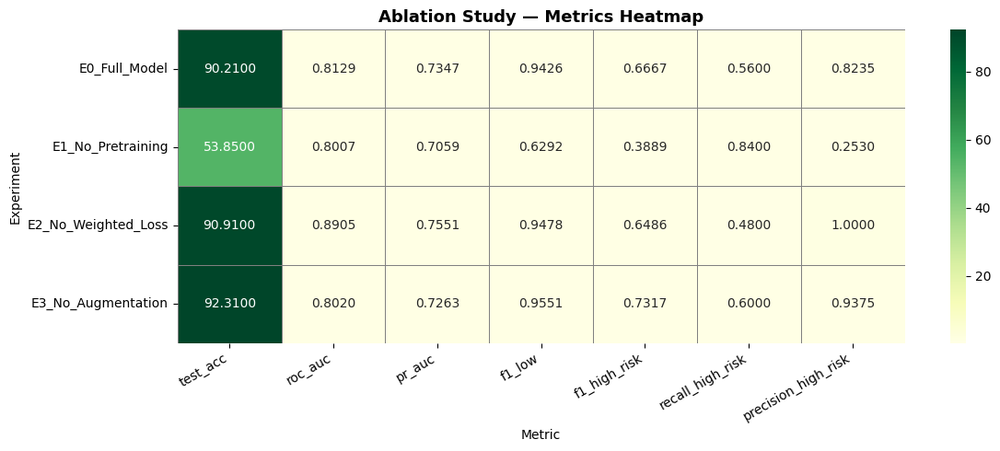

<div align="center">

# 🦷 AI-Assisted Risk Assessment of Inferior Alveolar Nerve Injury
### Segmentation + risk classification on dental panoramic radiographs

*Final Year Project · BSc (Hons) Artificial Intelligence & Data Science*
*Informatics Institute of Technology (IIT), Sri Lanka, in collaboration with Robert Gordon University, Aberdeen*
*Supervisor: Dr. Prasan Yapa*




</div>

---

## 📌 Overview

Removing a **mandibular third molar (M3M)**, the lower wisdom tooth, can injure the **inferior alveolar nerve (IAN)** when the tooth roots sit close to the nerve canal. Surgeons judge that risk by eye on a **dental panoramic tomograph (DPT)**.

This project builds a **three-model pipeline** that automates the assessment:

1. **IAN canal segmentation**: locate the nerve canal
2. **M3M segmentation**: locate the third molars
3. **Risk classification**: label each side of the jaw as **Low** or **High-Risk**, using the radiograph together with the segmentation overlay



<p align="center">
  
  <br/><sub>Preprocessing and ground-truth masks: original → Surgical CLAHE + USM → IAN canal mask → M3M mask</sub>
</p>

---

## 🧩 Stage 1: Segmentation (IAN canal & third molar)

Four segmentation approaches were compared on the same held-out test split. The **IAN canal** is the hard target: it is thin, low-contrast and often partly hidden by the molar roots.

| Model | IAN Dice | IAN mAP50 | IAN mAP50-95 | M3M Dice |
|---|:-:|:-:|:-:|:-:|
| YOLOv8s-seg (baseline) | 0.638 | – | – | 0.857 |
| YOLOv11m-seg + Surgical CLAHE | 0.649 | 0.955 | 0.389 | 0.870 |
| **U-Net + ResNet-50 (two models)** | **0.677** | **0.982** | **0.508** | **0.882** |

The final pipeline uses **two U-Net + ResNet-50 models**, one per structure. Each is trained with a Dice + BCE loss, cosine LR scheduling and early stopping. On the test set, **94.4%** of images reach IAN Dice > 0.5.

<p align="center">
  
</p>

<details>
<summary><b>Ablation studies & clinical proximity check</b></summary>
<br/>

Two ablations measure each training component's contribution to IAN mAP50-95: **subtract-one-out** (remove one component) and **isolate-one-only** (keep one component). Augmentation contributes most, then preprocessing, then the Dice + BCE loss.

<p align="center"></p>

A clinically meaningful check compares the **predicted vs ground-truth IAN-to-molar distance**, which is the quantity a surgeon actually cares about:

<p align="center"></p>
</details>

---

## 🎯 Stage 2: Binary risk classification

Each radiograph is split into **left and right sides**, which are matched to expert risk labels. That gives 713 labelled samples from 375 unique images. The test set has **143 samples (118 Low, 25 High-Risk)**, so results are reported with ROC-AUC, PR-AUC and **High-Risk recall**, since a missed high-risk case is the critical failure mode.

| Model | Input | Test Acc. | ROC-AUC | PR-AUC | High-Risk Recall |
|---|---|:-:|:-:|:-:|:-:|
| ResNet-50 | Raw DPT | 90.21% | 0.851 | 0.721 | 0.48 |
| DenseNet-121 | Raw DPT | 92.31% | 0.814 | 0.779 | **0.76** |
| DenseNet-121 | Composite overlay | 93.01% | 0.854 | 0.798 | 0.72 |
| **EfficientNet-B0** | **Raw DPT** | **94.41%** | 0.858 | 0.793 | 0.68 |
| EfficientNet-B0 | Composite overlay | 91.61% | **0.874** | 0.721 | 0.64 |
| EfficientNet-B5 | Raw DPT | 92.31% | 0.873 | **0.804** | 0.60 |
| EfficientNet-B0 + CBAM | 7-channel fusion | 91.61% | 0.829 | 0.777 | 0.72 |
| DenseNet-121 + CBAM | 7-channel fusion | 79.02% | 0.777 | 0.678 | 0.60 |

> **7-channel fusion** stacks CLAHE raw DPT (×3) + a Sobel edge map (×1) + the composite segmentation overlay (×3), with the first convolution widened to 7 channels and **CBAM** (channel + spatial attention) on the backbone features.

<p align="center">
  
  
  <br/><sub>EfficientNet-B0 (raw DPT): no low-risk side misclassified; 17 / 25 high-risk sides caught</sub>
</p>

<details>
<summary><b>Classification ablation (EfficientNet-B0)</b></summary>
<br/>

Removing ImageNet pre-training collapses accuracy to 53.85%, which confirms that transfer learning is essential at this dataset size. Removing the class-weighted loss raises ROC-AUC but cuts High-Risk recall from 0.56 to 0.48.

<p align="center"></p>
</details>

---

## 📂 Repository structure

```
notebooks/
├── segmentation/
│   ├── unet/
│   │   ├── UNet_ResNet50.ipynb                      # ⭐ final IAN + M3M models
│   │   └── ablations/
│   │       ├── UNet_ResNet50_Ablation_IsolateOne.ipynb
│   │       └── UNet_ResNet50_Ablation_SubtractOne.ipynb
│   └── yolo/
│       ├── YOLOv8s_Baseline.ipynb
│       ├── YOLOv8s_Improved.ipynb
│       └── YOLO11m_Seg.ipynb
└── classification/
    ├── efficientnet/
    │   ├── EfficientNetB0_Baseline.ipynb            # ⭐ best test accuracy
    │   ├── EfficientNetB0_Composite.ipynb
    │   ├── EfficientNetB0_7Ch_CBAM.ipynb
    │   ├── EfficientNetB5_Baseline.ipynb
    │   └── ablations/
    │       ├── EfficientNetB0_Ablation_IsolateOne.ipynb
    │       └── EfficientNetB0_Ablation_SubtractOne.ipynb
    ├── densenet/
    │   ├── DenseNet121_Baseline.ipynb
    │   ├── DenseNet121_Composite.ipynb
    │   └── DenseNet121_7Ch_CBAM.ipynb
    └── resnet/
        └── ResNet50_Baseline.ipynb
assets/                                              # figures used in this README
```

## 🚀 Running the notebooks

The notebooks were developed on **Google Colab** (GPU) and locally on Windows with CUDA.

```bash
pip install torch torchvision ultralytics segmentation-models-pytorch \
            opencv-python scikit-learn pandas matplotlib seaborn pycocotools
```

1. Open a notebook and update the path constants in the **Configuration** cell (`IMAGES_DIR`, `EXCEL_PATH`, `OUTPUT_DIR`, etc.).
2. Segmentation notebooks expect **COCO-format polygon annotations** for the IAN canal and M3M.
3. Classification notebooks expect the radiographs plus a `Risk_assessment.xlsx` file with per-side risk labels.

> ⚠️ **Data availability:** the clinical radiographs and annotations are not included in this repository.

## 🛠️ Tech stack

PyTorch · torchvision · segmentation-models-pytorch · Ultralytics YOLO · OpenCV · scikit-learn · pandas · matplotlib / seaborn · Google Colab

---

<div align="center">
<sub>Built by <a href="https://github.com/minudakaliyanage">Minudaka Liyanage</a> · For research and educational use, not a certified medical device.</sub>
</div>
